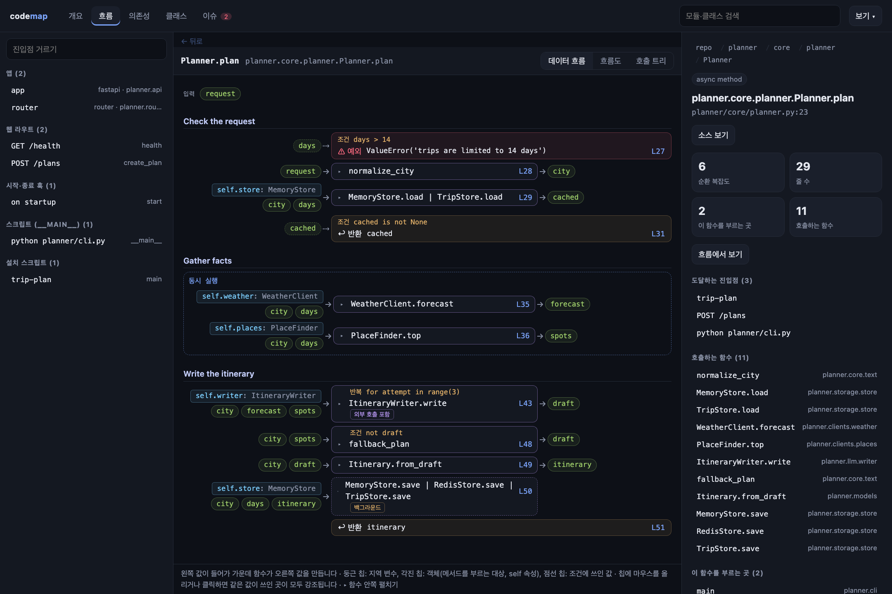
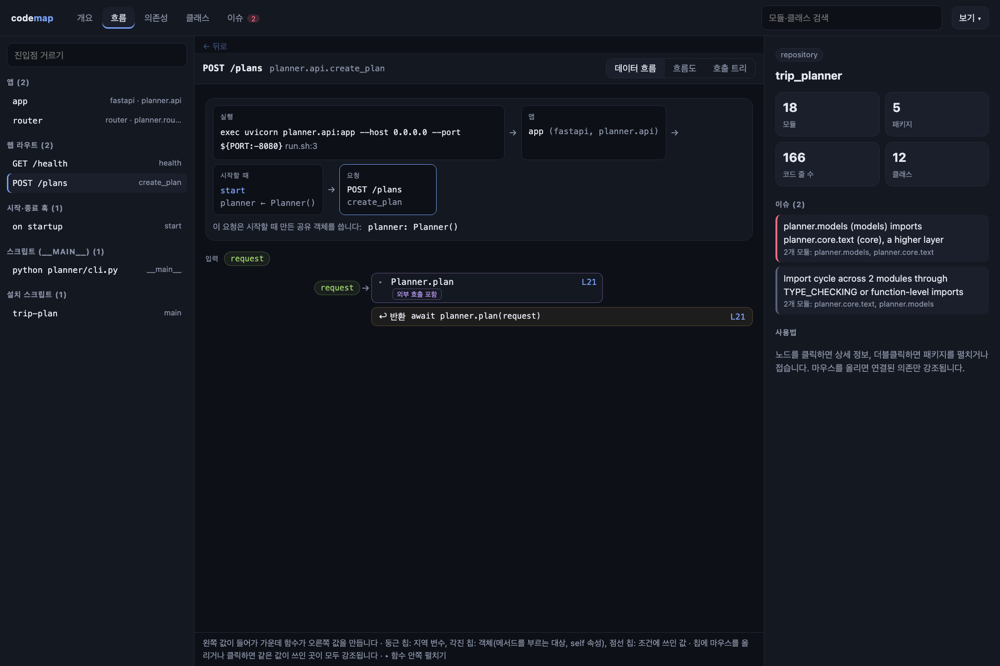
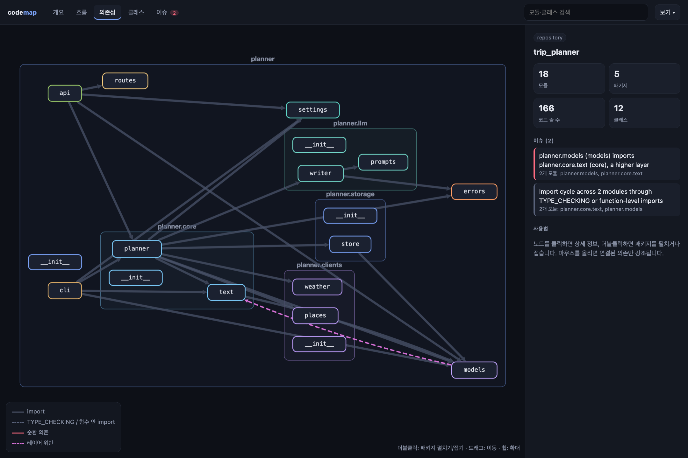
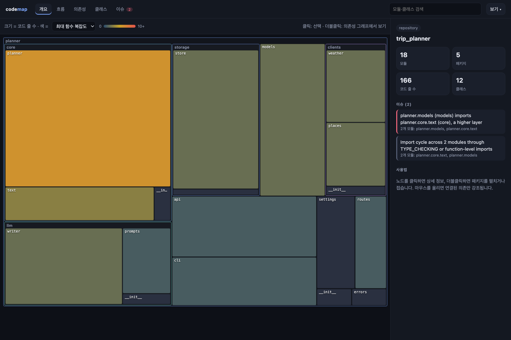

# codemap

Python 리포지토리의 구조를 정적 분석해서 브라우저에서 탐색할 수 있게 보여주는 도구입니다.
패키지·모듈 의존 관계, 클래스 상속, 순환 import, 레이어 규칙 위반, 자주 바뀌면서 복잡한 코드(핫스팟)를 한눈에 볼 수 있습니다.

- 표준 라이브러리 `ast`로 분석하고, 분석 대상 코드는 실행하지 않습니다.
- 모듈 600개 안팎의 리포를 1초 안팎에 분석합니다(networkx 583개 0.9초). 바뀐 파일만 다시 읽는 캐시가 있습니다.
- 결과는 `graph.json` 하나로 나오고, 로컬 웹 화면·단일 HTML·Mermaid로 볼 수 있습니다.
- `codemap check`로 CI에서 순환 import와 레이어 위반을 막을 수 있습니다.

## 화면 예시

[`examples/trip_planner`](examples/trip_planner)는 이 README를 위해 지어낸 작은 여행 일정 서비스입니다(FastAPI, httpx, OpenAI, Redis). 직접 열어 보려면 `codemap serve examples/trip_planner`를 실행합니다.

**흐름 · 데이터 흐름** — `Planner.plan` 한 함수. 줄마다 왼쪽 값이 가운데 호출로 들어가 오른쪽 변수가 됩니다. 조건에 쓰인 값은 예외·반환으로 이어지고, `asyncio.gather`의 두 작업이 묶여 있으며, 재시도 반복과 백그라운드 저장이 표시됩니다.



**흐름 · 요청** — `POST /plans`. 실행 명령(`run.sh`) → FastAPI 앱 → 시작 훅이 만드는 공유 객체 `planner` → 이 요청 순서로 서비스가 뜨는 과정을 보여줍니다.



**의존성** — 패키지 안 모듈 사이의 import. 보라 점선은 레이어 위반입니다(`models`가 상위 레이어 `core`를 import).



**개요** — 크기는 코드 줄 수, 색은 함수 복잡도입니다.



## 설치

화면(viewer)은 빌드한 결과를 Python 패키지에 넣어 배포하므로, 소스에서 설치할 때는 화면을 먼저 빌드합니다.
Python 3.12 이상, [uv](https://docs.astral.sh/uv/), Node.js 20 이상이 필요합니다.

```bash
git clone https://github.com/eddie94/code-analyzer.git
cd code-analyzer/viewer && npm ci && npm run build && cd ..
uv tool install .
```

`codemap check`나 `codemap analyze`처럼 화면이 필요 없는 명령만 쓸 때는 빌드 없이 바로 실행할 수 있습니다.

```bash
uvx --from git+https://github.com/eddie94/code-analyzer codemap check .
```

## 사용법

```bash
codemap serve path/to/repo          # 분석하고 브라우저에서 열기 (http://127.0.0.1:8700)
codemap export path/to/repo -o map.html   # 서버 없이 열리는 HTML 파일 하나로 저장
codemap analyze path/to/repo -o out       # out/graph.json 만들기
codemap render out/graph.json --level package > deps.mmd   # Mermaid로 변환
codemap check path/to/repo          # 순환 import·레이어 위반이 있으면 exit 1
```

공통 옵션:
- `--no-cache`: 캐시를 쓰지 않고 모든 파일을 다시 분석합니다. 캐시는 `~/.cache/codemap`에 저장됩니다(`CODEMAP_CACHE_DIR`로 변경).
- `--jobs N`: 파싱에 쓸 프로세스 수입니다.

### 화면

| 탭 | 내용 |
|---|---|
| 개요 | 패키지·모듈 treemap. 크기는 코드 줄 수, 색은 핫스팟·커밋 수·복잡도·불안정성·이슈 수 중에서 고릅니다. |
| 흐름 | 진입점(웹 라우트, 시작 훅, `__main__`, CLI 명령, `[project.scripts]`)이나 앱을 고르면 실행 흐름을 보여줍니다. 위에는 서비스가 어떻게 뜨는지(실행 명령 → 앱 → 시작 훅이 만드는 공유 객체 → 요청)를 보여줍니다. 아래 기본 화면인 "데이터 흐름"은 함수마다 어떤 값이 어느 호출로 들어가 어떤 변수가 되는지를 한 줄씩 그립니다. 조건에 쓰인 값에서 반환·예외 지점으로 점선이 이어지고, `asyncio.gather`의 결과는 각 동시 작업에 나눠 붙습니다. 칩에 마우스를 올리면 같은 값이 쓰인 곳이 모두 강조되고, ▸로 호출한 함수 안쪽을 같은 모양으로 펼치며, 이름을 더블클릭하면 그 함수에서 다시 시작합니다(← 뒤로, 브라우저 뒤로 가기로 돌아옴). "흐름도"는 단계 주석·조건·반복·동시 실행 단위로 묶어 보조 함수를 접은 화면이고, "호출 트리"는 모든 호출을 소스 순서대로 보여줍니다. |
| 의존성 | import 그래프. 패키지를 더블클릭해 펼치고 접습니다. 순환은 빨간선, 레이어 위반은 보라 점선, TYPE_CHECKING·함수 안 import는 점선입니다. |
| 클래스 | 패키지나 모듈 단위의 상속 다이어그램(UML 형식, 부모가 위). |
| 이슈 | 순환 import(가장 짧은 경로 예시 포함), 레이어 위반, 해석 안 된 import, 파싱 오류. "그래프에서 보기"로 경로를 강조합니다. |

노드를 고르면 오른쪽 패널에 지표, 의존 대상, 클래스·함수 목록이 나오고, "소스 보기"로 코드를 열 수 있습니다.
보고 있는 탭·선택·펼침 상태는 URL에 저장되므로 링크로 공유할 수 있습니다.

### 순환 import 분류

| 종류 | 심각도 | 뜻 |
|---|---|---|
| 직접 순환 | warning | 모듈들이 import 시점에 서로를 불러옵니다. 불러오는 순서에 따라 `ImportError`가 날 수 있습니다. |
| `__init__`를 거치는 순환 | info | 하위 모듈이 자기 패키지를 import하고, 패키지 `__init__`이 그 하위 모듈을 다시 불러오는 경우. 흔한 패턴입니다. |
| 타입·지연 import 순환 | info | `if TYPE_CHECKING:` 블록이나 함수 안 import로만 닫히는 순환. 로딩은 깨지지 않습니다. |

### 지표

| 지표 | 설명 |
|---|---|
| 코드 줄 수 | 빈 줄·주석·docstring 제외 |
| 복잡도 | 함수별 순환 복잡도(분기 수 + 1). 모듈·패키지는 안에 든 함수의 최댓값 |
| 불안정성 | 나가는 의존 / (들어오는 의존 + 나가는 의존). 0은 다른 곳이 많이 기대는 안정된 코드, 1은 남에게만 기대는 코드 |
| 커밋 수 | 최근 `churn_days`일(기본 90일) 동안 파일을 바꾼 커밋 수. git 저장소일 때만 |
| 핫스팟 | 커밋 수 × 최대 복잡도. 자주 바뀌면서 복잡해서 먼저 손볼 후보 |

## 설정

`pyproject.toml`의 `[tool.codemap]`에 둡니다(없으면 `.codemap.toml`의 최상위 키).

```toml
[tool.codemap]
source_roots = ["src"]                  # 생략하면 src 레이아웃을 자동 감지
exclude = ["**/migrations/**"]          # .gitignore 형식
fail_on = ["layer_violation", "cycle"]  # codemap check가 실패로 볼 이슈
churn_days = 90                         # 0이면 git 기록을 보지 않음

# 위 레이어는 아래 레이어를 import할 수 있고, 반대는 위반입니다.
[[tool.codemap.layers]]
name = "api"
modules = ["app.api.*"]                 # app.api 자신과 그 아래 전부

[[tool.codemap.layers]]
name = "service"
modules = ["app.service.*"]

[[tool.codemap.layers]]
name = "repository"
modules = ["app.repo.*"]
```

`fail_on`에 쓸 수 있는 값: `layer_violation`, `cycle`(직접 순환만), `parse_error`, `unresolved_import`.

## CI에서 쓰기

GitHub Actions에서는 `--format github`을 주면 위반 위치가 PR 파일 위에 주석으로 표시됩니다.

```yaml
- uses: astral-sh/setup-uv@v6
- run: uvx --from git+https://github.com/eddie94/code-analyzer codemap check . --format github
```

## 개발

```bash
uv sync                                     # Python 의존성
uv run pytest && uv run ruff check .        # 분석기 테스트·린트
cd viewer && npm ci && npm test && npm run build   # 화면 테스트·빌드
```

- 화면만 고칠 때: `uv run codemap serve <repo> --no-open`을 띄워 두고 `cd viewer && npm run dev`. Vite가 `/api`를 8700번으로 넘깁니다.
- `src/codemap/model.py`(graph.json 형식)를 바꾸면 `cd viewer && npm run gen:types`로 TypeScript 타입을 다시 만듭니다. 잊으면 `tests/test_schema.py`가 실패합니다.
- 설계와 결정 사항은 [SPEC.md](SPEC.md)에 있습니다.
